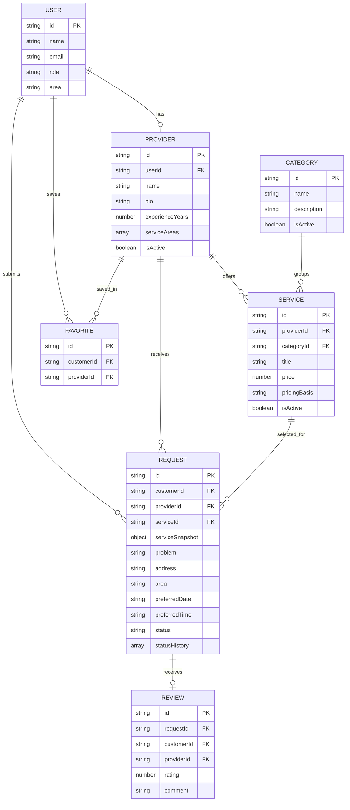
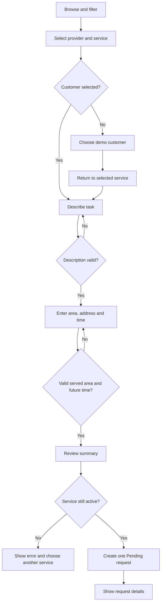
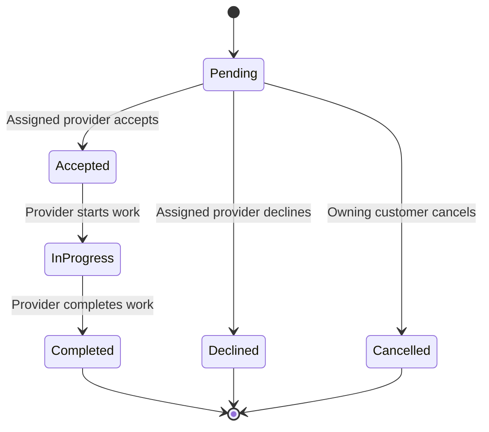
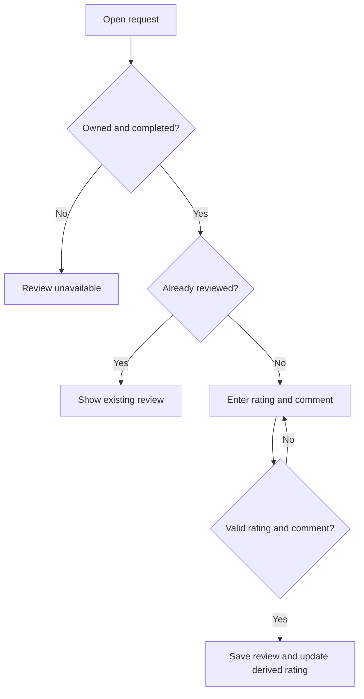
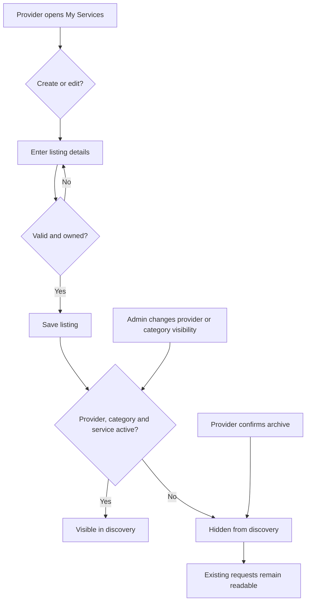

# System models, sitemap and user flows

Mermaid blocks render in many Markdown viewers, including GitHub. `use-cases.puml` supplies standard UML use-case notation. IDs are conceptual keys in arrays; there is no database server.

## Conceptual ERD

Reviews also reference a customer and provider; these must match their completed request. The request service snapshot preserves title/price/provider-name history. Status history objects contain status, at and actor fields. Favorites are unique by customer/provider pair. A review is unique by request ID.

## Sitemap

| Public                                               | Customer workspace                       | Provider workspace                       | Admin workspace                          |
| ---------------------------------------------------- | ---------------------------------------- | ---------------------------------------- | ---------------------------------------- |
| Home `/`                                             | Overview `/dashboard`                    | Overview `/dashboard`                    | Overview `/dashboard`                    |
| Services `/services`                                 | My requests `/dashboard/requests`        | Incoming requests `/dashboard/requests`  | All requests `/dashboard/requests`       |
| Provider `/providers/:id`                            | Request detail `/dashboard/requests/:id` | Request detail `/dashboard/requests/:id` | Request detail `/dashboard/requests/:id` |
| Request `/request/:id` (customer selection required) | Saved providers `/dashboard/favorites`   | My services `/dashboard/services`        | Providers `/dashboard/providers`         |
| Demo access `/demo-access`                           | Profile `/dashboard/profile`             | Profile `/dashboard/profile`             | Categories `/dashboard/categories`       |
| About `/about`, Contact `/contact`                   |                                          |                                          |                                          |

Routes are encoded after `#` for static hosting. Workspace navigation is determined by the current demo user's role.

## Request submission flow

## Request lifecycle

## Review flow

## Service management / visibility flow

## Important use case descriptions

**UC-01 Request service:** Actor Customer. Preconditions: selected customer and active service. Main flow: find service, describe task, choose served area/future time, review, submit. Alternate flows: choose demo account first; correct invalid fields; active state changes before submission. Postcondition: one Pending request with immutable service snapshot.

**UC-02 Update request:** Actor Assigned Provider. Precondition: request is assigned to current provider and current status permits the action. Main flow: open request, accept/decline or advance accepted work, see timestamped history. Postcondition: valid new status visible to customer. Alternate: action rejected for other providers or terminal requests.

**UC-03 Review service:** Actor Owning Customer. Preconditions: Completed and no previous review. Main flow: rate 1–5, add comment, submit. Postcondition: one review; aggregate rating recalculated. Alternate: duplicate or ineligible submission rejected.

**UC-04 Manage listings:** Actor Provider. Main flow: create/edit own listing or confirm archive. Postcondition: discovery reflects active state; historical requests retain their original service information.

**UC-05 Moderate visibility:** Actor Administrator. Main flow: add/edit category or confirm provider/category deactivation. Postcondition: inactive offerings cannot receive new requests; old records remain.
